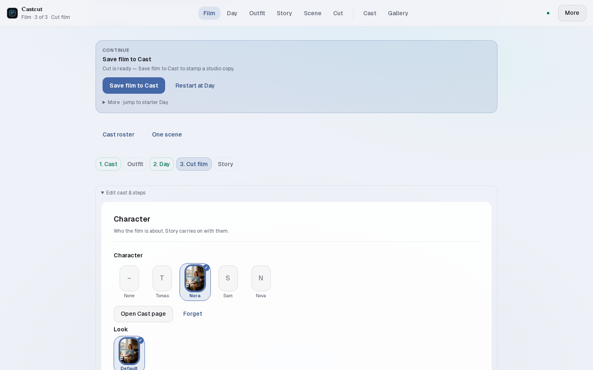
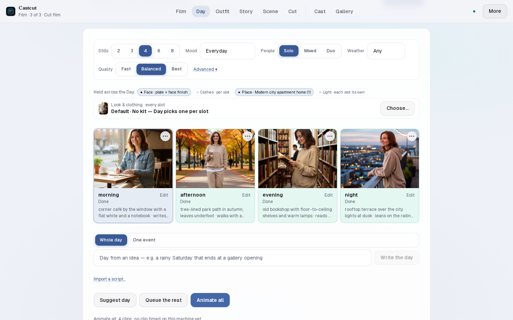
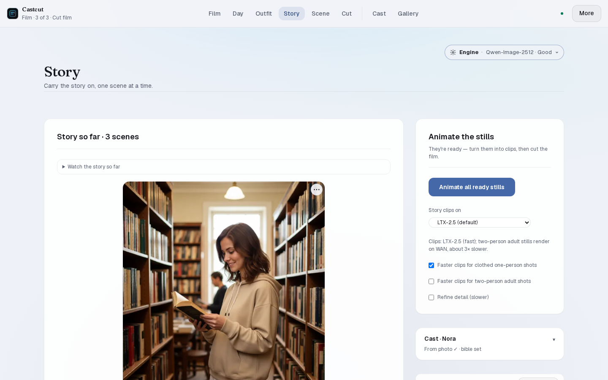
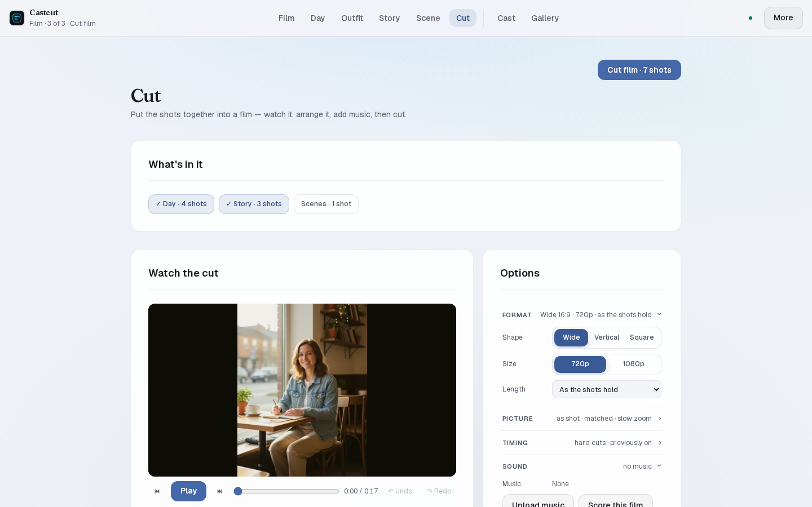
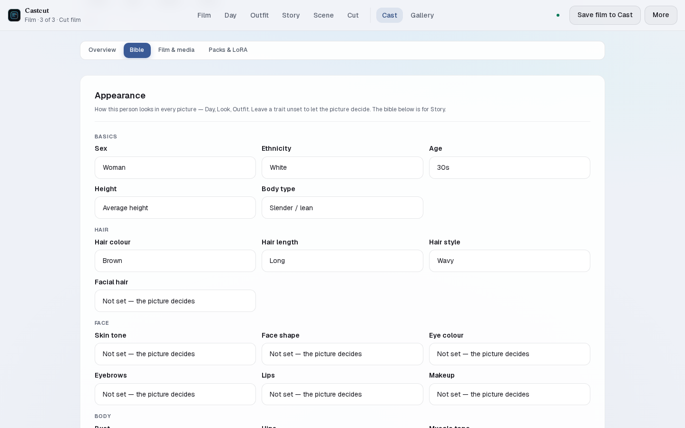
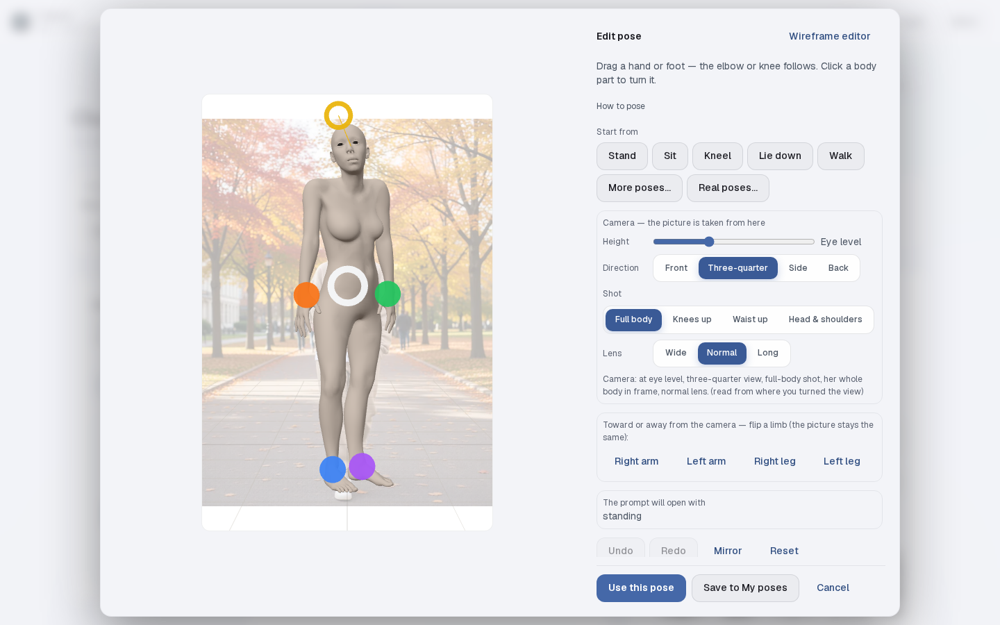
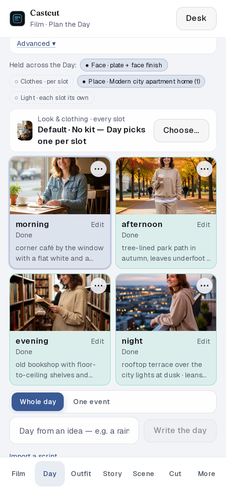
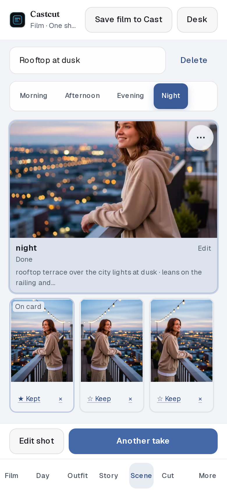

# Castcut

**Local character films with ComfyUI.** Cast → Outfit → Day → (Story · Scene) → **Cut**.

Formerly shipped as Prompt Studio / `llm-prompt-studio`. Package and GitHub repo are now [`castcut`](https://github.com/doodersrage/castcut). The classic prompt and image tools, without the film loop, live on as [**Prompt Studio**](https://github.com/doodersrage/prompt-studio), built on the shared core package [`prompt-studio-core`](https://www.npmjs.com/package/prompt-studio-core).

[](https://github.com/doodersrage/castcut/actions/workflows/ci.yml)
[](https://github.com/doodersrage/castcut/releases)
[](./LICENSE)

**Make a character, give her a day, cut the film — locally, with ComfyUI.** One consistent person across every still and clip.

### How it works

1. **Cast** — create a character once: a face plate, traits, a voice, her home and workplace.
2. **Outfit** — dress her: a kit, your own photo, or shoes you pick.
3. **Day** — plan 2–8 moments from morning to night; each becomes a still, then a clip. Give a moment a **line** and she says it, lip-synced, in her voice.
4. **Story** *(optional)* — the LLM offers four next scenes; pick one or write your own.
5. **Scene** *(optional)* — one shot, exactly as you want it: setting, beat, line, pose and camera. Render takes, ★ keep the best, then make it move.
6. **Cut** — the film's own step: watch the cut, drag the shots into order, trim and frame them, mix Day, Story and Scenes, add music (or **Score this film**), subtitles, narration and titles; export vertical, square or widescreen, or for an editor.

**Finishing tools** on any still or clip: **Sharpen & smooth** (SeedVR2 + RIFE), **Make more realistic** (WAN 2.2 low-noise re-render), **Copy moves from a video** (Wan Animate 2), **Direct a move** (pose her through a few beats on a 3D body, then render it), **Dance to music** (Wan-Dancer), **Lip-sync to a recording** (InfiniteTalk, one or two people), **Relight**, and **Sketch over a still**.

**Consistency:** one face (the Cast plate), one dressed plate per outfit, and the Cast's own places — set a photo of a real room and stills set there are built around it.

**Poses and camera:** a 3D pose editor (drag a hand or foot, start from Stand / Sit / Kneel / Lie down / Walk, or a real pose read from a photo) and one Camera row — height, direction, shot, lens — on every Day slot, Story beat and Scene. A pose check redoes a still that missed the pose.

**Docs:** [doodersrage.github.io/castcut](https://doodersrage.github.io/castcut/) — [Install](https://doodersrage.github.io/castcut/install/) · [Your first film](https://doodersrage.github.io/castcut/first-film/) · [Models](https://doodersrage.github.io/castcut/models/) · [Finishing tools](https://doodersrage.github.io/castcut/finishing-tools/)

**Get it:** [GitHub Releases](https://github.com/doodersrage/castcut/releases) (macOS `.dmg`, Windows `.exe`, Linux `.deb` / `.AppImage`) · `docker pull ghcr.io/doodersrage/castcut:latest` · [how to cut a release](docs/releasing.md)

On Linux, prefer the **`.deb`** (system WebKit, snappier UI) — details in [docs/desktop.md](docs/desktop.md).

## Screenshots

| | |
| --- | --- |
|  |  |
| **Film** — pick or create a Cast lead; Outfit → Day → Cut. | **Day** — one character from morning to night, stills in a reel, then **Cut film**. |
|  |  |
| **Story** — pick what happens next; each scene becomes a still (and a clip). | **Cut** — mix Day, Story and Scenes; watch it, set the shape, music and titles, then cut. |
|  |  |
| **Cast** — the Bible tab's Appearance: sex, ethnicity, age, height, body and hair, used in every picture. | **3D pose editor** — drag a hand or foot, start from a quick pose, set the camera. |

<p align="center">
  
  &nbsp;&nbsp;
  
</p>
<p align="center"><b>Mobile Studio</b> (<code>/m</code>) — the same film loop on a phone: Day, and a Scene with its takes.</p>

## Quick start

Requires **Node.js 22+** and a reachable **ComfyUI**.

```bash
npm install
cp .env.example .env.local   # set COMFYUI_API_URL
npm run dev
```

Open [http://localhost:47832](http://localhost:47832), then:

1. **Settings → Overview → Heal & ready** — installs the node packs and turns on the workflows.
2. **Settings → LLM → Built-in LLM** — one click for the language + vision model (or point it at LM Studio / Ollama).
3. **Settings → ComfyUI → Models** — install a still engine and LTX-2.5 ([which models for what](docs/models.md)).
4. **Film** → **Make a starter film**.

Docker: `cd docker && cp .env.example .env && docker compose up -d --build` — see [Configuration](docs/configuration.md). Day-2 ops (second GPU, new machine, users): [Operator guide](docs/operator.md).

## Pages

| Page | Route | What |
| --- | --- | --- |
| **Film** | `/play` | Start or resume a film on a Cast lead |
| **Cast** | `/characters` | Characters: looks, plates, voice, places, films, seasons |
| **Outfit** | `/fitting` | Clothing, shoes, try-ons, the dressed plate |
| **Day** | `/day` | The day plan, stills, clips, Cut film |
| **Story** | `/story` | Scene-by-scene stories with stills and clips |
| **Scene** | `/scene` | One shot as you want it — takes, keep the best, make it move |
| **Cut** | `/cut` | Put the film together: order, trim, music, titles, export |
| **Gallery** | `/gallery` | Everything rendered — filters by Cast, look, checks |
| **Queue** | `/queue` | What ComfyUI is doing |
| **Video · Compose · Refine · Inpaint** | | Single-shot tools under More |
| **Mobile Studio** | `/m` | The same film loop on a phone |
| **Settings** | `/settings` | Heal, LLM, ComfyUI, models, users, backup |

The classic prompt and image tools (Generate, Format, Pet, Fantasy, Topics, Variations, ControlNet…) live on in [**Prompt Studio**](https://github.com/doodersrage/prompt-studio).

## Engines

| Job | Engines |
| --- | --- |
| **Stills** | Qwen-Image 2.1 Turbo (default), Qwen-Image 2.1 Noct-Q / Noct-Q Fast, Qwen-Image-Edit 2511, Qwen Rapid AIO (SFW / NSFW), Bria Fibo 2.0 Edit Turbo, FLUX.2 Klein |
| **Clips** | LTX-2.5 (talking clips, sound), WAN 2.2 Rapid AIO, MiniMax-H3 |
| **Finishing** | SeedVR2, RIFE, WAN 2.2 T2V low-noise 14B, Wan Animate 2 (Copy moves, the Director), Wan-Dancer, InfiniteTalk, Qwen-Edit Relight |
| **Music** | ACE-Step 1.5 |
| **Language / vision** | Built-in llama.cpp, LM Studio, Ollama, or a hosted provider |

Optional: the [Diffusers engine](https://github.com/doodersrage/castcut-diffusers) and cloud engines (Fal, Replicate, Grok, Gemini, Runway, Luma) for the single-shot tools.

## ComfyUI integration

- **Workflow takeover** at queue time — [docs/workflow-takeover.md](docs/workflow-takeover.md)
- **Castcut nodes** (optional checks inside the job) — [docs/castcut-nodes.md](docs/castcut-nodes.md)
- **HTTP API** — [docs/http-api.md](docs/http-api.md) (live catalog: `GET /api`; health, probe, invite, SMTP)
- **Architecture** — [docs/architecture.md](docs/architecture.md)
- **Operator guide** — [docs/operator.md](docs/operator.md)
- **Optional Diffusers engine** — [castcut-diffusers](https://github.com/doodersrage/castcut-diffusers) (its own repo; Settings → ComfyUI → *Engine for Generate & Video* installs it)
- **Optional cloud engines** — Settings → ComfyUI → *Engine for Generate & Video*, behind the cloud toggle (Fal, Replicate, ChatGPT, Gemini, Grok, Runway, Luma). Set the matching env key or a browser key, then queue (Image 1 becomes img2img when present). Fal/Replicate/Grok/Gemini/Runway/Luma can queue clips; ChatGPT is stills-only. Model datalists cover current FLUX.2 / Kling / WAN / Seedream / HiDream / Veo / Gen-4.5 / Ray presets — type a custom endpoint id if your account has access to something newer.

## CLI & data scripts

```bash
npm run prompt:cli -- duo --hints "..."
npm run locations:count
npm run clothing:count
```

Details: [docs/data-catalogs.md](docs/data-catalogs.md) and [docs/performance/guide.md](docs/performance/guide.md).

**Full docs (searchable):** `pip install -r docs/requirements-docs.txt && npm run docs:serve` → [http://127.0.0.1:8000](http://127.0.0.1:8000)

## Development

Built solo. Claude (Cursor / Claude Code) helped mostly with tests and CI — architecture,
product direction, and the bulk of implementation are mine. Noted here upfront rather than
left for someone to dig out of the branch history.

## License

[MIT](./LICENSE) © 2026 Robert McDowell. Third-party model weights you download (e.g. via Hugging Face) remain under their own licenses. Day and Story's real-world reference poses are skeletons only — read from openly licensed photos (CC0, public domain, CC BY, CC BY-SA), projected from the CMU Graphics Lab Motion Capture Database, or mapped from the COCO 2017 person keypoint annotations; no photo ships with the app. See [the pose reference credits](docs/pose-reference-credits.md); the harvesters are in [scripts/pose-refs](scripts/pose-refs/README.md). The 3D pose editor's bodies are Blender Studio's *Human Base Meshes* (CC0), rigged for Castcut — see [public/pose-3d/LICENSE.md](public/pose-3d/LICENSE.md).
