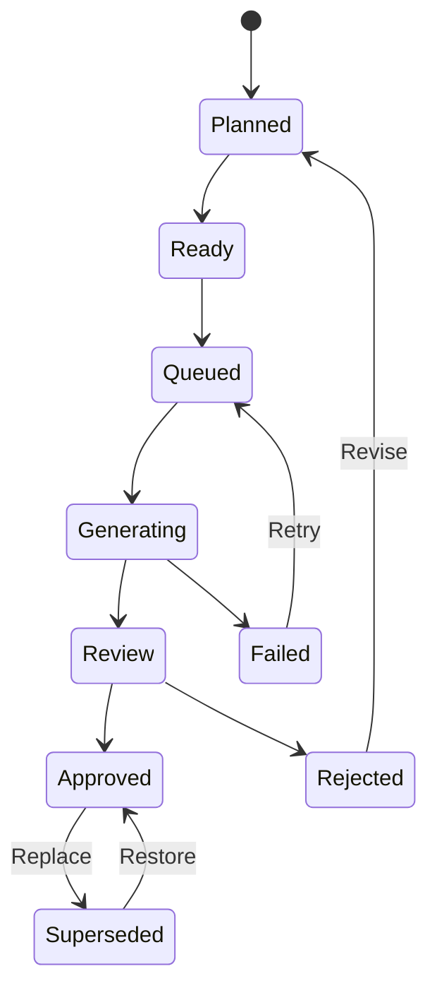
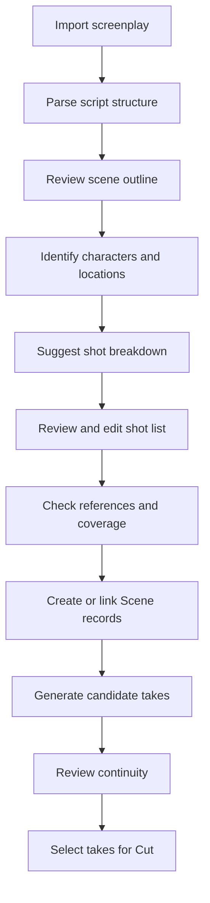

# Castcut — product and engineering roadmap

**Start:** Tuesday 27 October 2026, about 7 pm.
**First session:** M0 — the code-level audit (section 13): the Scene take model, Queue
persistence, the Cut clip representation, and the backup / restore path. Output: a list of exact
files and functions to change, then small, independently testable GitHub issues.

---

Castcut already has more of the advanced foundation than a generic roadmap would assume. The
README documents multi-take Scene generation, the Director and 3D pose editor, camera controls,
multiple generation engines, sound and finishing tools, and a Cut workflow that combines Day,
Story and Scene content. Recent commits show active work on pose accuracy, real-render testing,
mobile usability and generation reliability.

So the next cycle should make these capabilities behave like one coherent filmmaking system
rather than add a large number of disconnected pages.

The plan below covers product requirements, data contracts, implementation tasks, dependencies,
testing and release gates.

## 1. Define the product outcome first

The target is a creator who can:

1. Develop a character, look, world and story.
2. Plan scenes and individual shots.
3. Generate multiple candidate takes using local or optional cloud engines.
4. Check visual continuity and approve the best take.
5. Assemble and revise a film without losing prior work.
6. Finish audio, subtitles and titles.
7. Export the film and reopen the project with its production history intact.

The main measure of success is how reliably a creator can finish a film, not how many generation
tools the app contains.

Three product-level metrics:

- **Completion rate** — the share of started projects that reach a successful film export.
- **Recovery rate** — the share of interrupted or failed jobs users can continue from without
  losing approved work.
- **Revision cost** — the number of manual steps needed to replace a shot while keeping its
  surrounding edit and references.

Measure baselines before changing anything, or there is no way to tell whether the roadmap helps.

## 2. Priority order

| Priority | Area                                                                                                         |
| -------- | ------------------------------------------------------------------------------------------------------------ |
| **P0**   | Production data integrity — protect takes, references, jobs, edits and existing projects; set the contracts later work depends on |
| **P0**   | Take revisions and recovery — repeatable, reviewable, safe-to-revise generation; extend Scene's take selection |
| **P1**   | Continuity and quality assurance — turn plates, outfit references, pose checks and scene info into actionable checks |
| **P1**   | Script and shot planning — a structured planning layer from story intent to Scene generation and Cut assembly |
| **P1**   | Editorial finishing and delivery — editing reliability, audio, interchange, portable project archives       |
| **P2**   | Director production orchestration — a guided end-to-end workflow over planning, generation, review, finishing |

Ordered by dependency, not visual appeal. A Director dashboard is worth little if it can't
reliably keep the takes and edits it orchestrates.

## 3. Workstream A — Production data and asset integrity (P0, do first)

**Objective:** every generated asset, shot decision and editorial change has a reliable identity
and history.

### A1. Audit the existing data model

Trace how the app stores today:

- Cast records, appearance traits, face plates and voices.
- Outfits, dressed plates and location references.
- Day slots, Story beats and Scene records.
- Still and video takes, including framed or processed variants.
- Queue jobs, ComfyUI workflow inputs and output files.
- Cut clips, trims, titles, audio and export settings.
- Backup and restore.

Build a feature matrix with three states — `existing`, `partial`, `missing`. Every proposed
feature links to the existing code or names the new module it needs.

### A2. Canonical asset references

One generated image can have several related files: original, cropped frame, refined image,
video, thumbnail, perhaps a derived audio track. They shouldn't be treated as unrelated.

Proposed logical contract (not a claim about existing types — adapt to the current persistence
model; don't add a duplicate registry if one exists):

```ts
type AssetRecord = {
  id: string;
  projectId: string;
  kind: 'image' | 'video' | 'audio' | 'document';
  role: 'source' | 'derived' | 'thumbnail' | 'export';
  storagePath: string;
  mimeType: string;
  byteSize: number;
  checksum?: string;
  parentAssetId?: string;
  createdAt: string;
  metadata: Record<string, unknown>;
};
```

Tasks:

1. Define a canonical asset identifier.
2. Record relationships between source and derived media.
3. Validate that an asset exists before a take or edit references it.
4. Tell an unavailable file apart from a deliberately deleted one.
5. Stop cleanup jobs removing media still referenced by approved takes or film edits.
6. Make backup and restore keep those relationships.

**Done when:** restoring a project into a clean data directory keeps its approved takes,
reference links and edit composition — or reports clearly what couldn't be restored.

### A3. Compatibility and migration rules

- Give new persisted records explicit schema versions.
- Idempotent migrations for older project data.
- Back up affected data before destructive migrations.
- Test opening and saving existing projects with the new code.
- Rollback or recovery if a migration fails.

Don't force Day, Story and Scene into a new schema just to unify their interfaces — use adapters
or linked records.

## 4. Workstream B — Shot and take lifecycle (P0, first user-visible feature)

Scene already has a take strip and Keep. Extend that into one persistent lifecycle across the app.

### B1. Shot lifecycle



A logical state machine, not necessarily a literal enum on every current record. A take's status
and a shot's status stay distinct: a shot can be approved while other candidate takes are still
under review.

### B2. Immutable take provenance

Each successful take keeps:

| Field                      | Purpose                                                    |
| -------------------------- | ---------------------------------------------------------- |
| Shot ID                    | The creative decision being rendered                       |
| Take ID                    | This particular result                                     |
| Prompt and negative prompt | The generation instructions                                |
| Model and version          | The engine and model used                                  |
| Workflow snapshot          | The relevant ComfyUI graph or engine configuration         |
| Seed and parameters        | What's needed to reproduce it, where supported             |
| Reference asset IDs        | Character, outfit, location, pose and image inputs         |
| Output asset IDs           | Stills, video, audio and derived frames                    |
| Job ID and timestamps      | Diagnosis and provenance                                   |
| User decision              | Selected, rejected or restored                             |

Keep credentials separate — never in workflow snapshots or project exports.

### B3. Take comparison and restoration

In small steps:

1. Persist each successful take on its own.
2. A selected-take pointer on the shot (or its existing equivalent).
3. A comparison view for two or more candidate takes.
4. Keep, Reject, Restore and Generate another take.
5. Update Cut references when the user explicitly picks a replacement.
6. Keep the old edit and take if the replacement fails.
7. A project history entry for important changes.

The comparison view: synchronized playback for video, side-by-side stills, and the settings that
differ between takes.

### B4. Non-destructive revisions

When replacing a shot already used in Cut, ask whether to:

- Replace this occurrence only.
- Replace every linked occurrence of the shot.
- Keep the new take as a candidate without changing the film.

No implicit global replacement — a shot may appear several times with different trims or roles.

**Done when:** a user can generate, compare, approve, replace and restore a take after
restarting Castcut, without losing prior media or changing unrelated edit decisions.

## 5. Workstream C — Continuity and production bible (P1, major differentiator)

The ingredients exist: Cast appearance, outfit plates, location references, the 3D pose editor,
camera settings, pose checks. Next, one system that checks shots against production intent.

### C1. Structured production bible

Extend existing records where practical. Cover:

- Characters and approved visual references.
- Outfits and the scenes each is valid in.
- Locations and important set details.
- Props and their visual references.
- Character relationships and story state.
- Scene chronology, time of day, environmental conditions.
- Approved camera and composition requirements.
- Audio and voice assignments.

Each item gets a stable ID and optional versions. A new character plate must not silently change
the reference attached to every previously approved shot.

### C2. State across scenes

A deliberately simple first version:

```ts
type SceneState = {
  sceneId: string;
  characterStates: Array<{
    characterId: string;
    outfitId?: string;
    position?: string;
    injuries?: string[];
    carriedPropIds?: string[];
    emotionalBeat?: string;
  }>;
  locationId?: string;
  timeOfDay?: string;
  continuityNotes: string[];
  basedOnSceneIds: string[];
};
```

Position and emotion can start as human-readable values before anything more formal.

### C3. A layered continuity engine

1. **Deterministic validation** — missing references, invalid files, wrong output dimensions,
   absent audio, mismatched shot metadata. Definite pass / fail.
2. **Visual similarity** — compare a frame with approved face, outfit or location references.
   Calibrate thresholds on representative examples; one threshold won't fit every model, pose or
   light.
3. **Semantic review** — a vision-language model looks for missing props, wardrobe
   inconsistencies, wrong scene details, composition issues. Suggestions with evidence, not facts.
4. **Human approval** — accept a discrepancy, amend a rule, ask for another take, or approve an
   exception; keep the decision and its reason.

### C4. Actionable findings

Each finding carries:

- The rule or requirement checked.
- The shot and asset under review.
- The evidence.
- Severity and confidence, where they apply.
- A suggested fix.
- The user's decision and when it was made.

Don't block renders on an uncertain AI result. Only explicit hard requirements stop a shot being
marked production-ready.

### C5. Validate before trusting it

A small, hand-reviewed test set with known cases: right identity, changed hairstyle, wrong outfit,
missing prop, wrong framing, and a deliberately valid lighting change. Measure false positives and
false negatives separately — a checker that keeps flagging good shots loses the creator's trust.

**Done when:** a creator can see why a shot failed a continuity check, correct or override it,
and the result stays attached to the take.

## 6. Workstream D — Screenplay and shot planning (P1, new capability)

Not a replacement for Story. A structured planning layer that turns a script into a reviewable
list of scenes and shots, connected to Scene and Cut.

### D1. First release scope

Fountain and plain-text screenplays first; defer Final Draft until the basics are proven. Support:

- Scene headings and locations.
- Action and description.
- Character cues and dialogue.
- Parentheticals.
- Scene order and links back to the source text.
- User corrections where parsing is unsure.

Parsing and AI interpretation are separate steps — the original script is kept even when the AI
misreads a character or scene.

### D2. Screenplay pipeline



Tasks:

1. Screenplay import and preview.
2. Parse scenes and dialogue into a normalized internal form.
3. Resolve character and location names to existing Cast and location records.
4. Ask the user about unknown names instead of silently creating duplicates.
5. An editable shot list: shot type, framing, action, dialogue, intended duration.
6. Mark suggested content as AI-generated until the user approves it.
7. Connect each approved shot to Scene.
8. Pass selected takes to Cut without losing their script and scene links.

### D3. Coverage planning

Help decide what to generate, without imposing a style. A dialogue scene might suggest an
establishing or wide shot, a medium two-shot, a close-up per speaker, a reaction shot, and an
insert of a significant prop if the script calls for one. The creator can accept, delete or
rearrange; completeness follows the scene's needs, not a fixed checklist.

### D4. Protect work through script revisions

Match scenes and passages on stable IDs and source fingerprints; show a reconciliation screen when
matching is ambiguous. Never silently delete a shot or approved take because a line left the
script — flag it and let the creator keep, relink or archive.

**Done when:** a user can import a screenplay, edit its scene and shot plan, generate selected
shots, revise the script, and keep approved work with clear links to the source.

## 7. Workstream E — Cut, audio and editorial reliability (P1, extend the editor)

Cut already orders, trims, frames, and adds music, subtitles, narration, titles and export. Make
those safer and more predictable first — not a full NLE rebuild.

### E1. Editorial data model

An edit is a sequence of clip instances referencing source assets or takes; one take can appear
several times with different trims. A clip carries:

- Source take or asset ID.
- Timeline position and source in / out points.
- Track and order.
- Playback speed, where supported.
- Framing and transform.
- Audio gain and fades.
- Transition, if supported.
- A stable identity for undo / redo and revision tracking.

Use the existing Cut model where it already does this. The key is separating generated media from
the editorial decisions about it.

### E2. Editing safety first

In order:

1. Reliable save and restore of the current edit.
2. Undo / redo for reorder, trim, delete and replace.
3. Explicit confirmation before removing referenced media.
4. Shot replacement that keeps trims and other edit decisions.
5. Clear unsaved-changes and failed-save indicators.
6. Recovery after a browser or app crash.

Undo / redo works on edit commands or snapshots of edit state, never copies of video files.

### E3. Audio as separate tracks

Toward dialogue, narration, music, ambience and effects on their own tracks. First: placement,
trim, gain, fade in / out, mute / solo, waveforms. Later: automation curves, richer mixing, sync
aids.

Validate:

- Missing or mismatched audio files.
- Unexpected silence.
- Clipping and export loudness.
- Subtitle timing and encoding.
- Sample rate and channel compatibility.

Loudness and true-peak checks are warnings with configurable targets — no single broadcast
standard forced on everyone.

### E4. Export profiles and handoff

Named profiles (social vertical, square, widescreen, editor handoff), each with resolution, aspect
ratio, frame rate, codec, audio configuration and subtitle behaviour, validated before rendering.

For external editors:

1. A media manifest and portable asset package.
2. An editable timeline interchange format the chosen editors support.
3. A round-trip test that exports, imports and checks clip timing and media links.
4. Optionally, markers, titles and audio tracks.

**Done when:** replacing a shot or changing a trim doesn't damage other clips, saved edits survive
a restart, and export validation catches missing media and incompatible settings before the
expensive render.

## 8. Workstream F — Queue reliability and generation orchestration

Overlaps the take lifecycle but has its own acceptance criteria, since Castcut depends on external
engines, models and local hardware.

### F1. Standard job status and errors

One job model over every engine: Waiting · Preparing · Running · Finalizing output · Succeeded ·
Failed · Cancelled. Keep the engine's own error for diagnosis beside a plain explanation.
Distinguish recoverable failures, missing prerequisites, resource exhaustion and invalid inputs.

### F2. Safe retries

Before retrying:

- Check whether the previous run produced a valid output.
- Check whether the engine is still working on it.
- Reuse the original inputs and reference IDs.
- Don't create duplicate approved takes.
- Record each attempt separately.

A timed-out request doesn't mean the generation never happened — some engines finish after the
client stops waiting.

### F3. Prerequisite and resource checks

Before queueing, validate the model, workflow, custom nodes, reference assets and destination
storage. Where the information is reliable, estimate memory and warn about likely GPU exhaustion.
Useful diagnostics first; multi-GPU scheduling and cross-machine routing wait until the job
lifecycle is solid.

### F4. Test interrupted production

Repeatable tests for:

- ComfyUI restarting mid-job.
- Castcut restarting with jobs queued.
- A model disappearing after a project is opened.
- Output succeeding but metadata persistence failing.
- The disk filling up.
- A retry giving a different result from the original attempt.

**Done when:** jobs never silently overwrite good outputs, failures are understandable, and
recoverable work resumes without rebuilding the production.

## 9. Workstream G — The Film Director workspace (P2, after the foundations)

Castcut's Director already means directing motion with poses and camera. Keep that meaning; the
production-level orchestration is a separate **Film Director** workspace. It coordinates the film;
it is not another generation engine.

### G1. Production overview

Illustrative layout (not a current screen):

```
Film production                                   In progress
─────────────────────────────────────────────────────────────
  12 planned shots   7 approved   2 generating   3 need review

Next actions
  Scene 1 · Establishing shot      Approved · ready for Cut
  Scene 2 · Dialogue close-up      Generation in progress
  Scene 3 · Reaction shot          Continuity warning
```

### G2. Guided actions

- Resolve missing character, outfit or location references.
- Generate missing coverage.
- Review failed jobs and retry the eligible ones.
- Review continuity findings.
- Approve takes.
- Send approved shots to Cut.
- Run the final delivery checklist.

Each action calls existing functionality through defined interfaces — no copies of the Scene
renderer, Queue or Cut logic in the Director page.

### G3. Automation, gradually

Recommendations with explicit approval first. Later, narrowly scoped automation (e.g. three
candidate stills for each approved shot plan), with limits on concurrent jobs, GPU memory,
retries and generation cost where it applies, and pause / cancel controls.

**Done when:** the workspace finds missing work, starts existing operations and tracks
completion, without bypassing take history, review or editing.

## 10. Milestones and release gates

Estimates assume one developer with coding assistance and reuse of existing modules; they are not
from a code-level estimate.

| Milestone        | Work                                                                 | Estimate  |
| ---------------- | -------------------------------------------------------------------- | --------- |
| M0 — Discovery   | Code map, feature inventory, test baseline, data contracts           | 3–5 days  |
| M1 — Reliability | Take provenance, history, selection, recovery, safe retry            | 1–2 weeks |
| M2 — Continuity  | Production bible links, scene state, checks, findings UI             | 2–4 weeks |
| M3 — Planning    | Script import, scene parsing, editable shot list, coverage           | 2–4 weeks |
| M4 — Finishing   | Edit-state safety, audio, export and archives                        | 2–4 weeks |
| M5 — Director    | Production overview, orchestration, guided actions                   | 1–3 weeks |
| Hardening        | Compatibility, usability, performance, recovery, release validation  | 1–2 weeks |

About 9–19 weeks in all, with some overlap. A roadmap estimate, not a commitment.

Release gates:

- **M0:** a written inventory of existing and missing functionality.
- **M1:** automated tests proving take restoration and failure recovery.
- **M2:** a reviewed continuity test set with measured false-positive and false-negative rates.
- **M3:** a real screenplay imported, edited, rendered and assembled without losing source links.
- **M4:** a film reopened, edited, exported and handed off with media relationships intact.
- **M5:** the Director workspace coordinates the whole workflow without duplicating engine or
  editing logic.
- **Hardening:** existing projects still work, backup restore succeeds, critical end-to-end tests
  pass.

## 11. Testing strategy

- **Unit and contract tests** — migrations, state transitions, take selection, provenance,
  continuity rules, script parsing, edit commands; no generation models.
- **End-to-end tests** — the existing Playwright setup with isolated data: create a shot, pick a
  take, restore a version, assemble a Cut, recover after a simulated restart.
- **Real-engine tests** — a separate, small suite against a real ComfyUI: representative still
  and video generation, output persistence, recovery from real engine errors.

Reuse the existing real-render harnesses where they already cover the behaviour; don't add an
overlapping suite.

## 12. Deliberately deferred

- A full replacement for a professional NLE.
- Automatic full-film generation with no user review.
- 3D set reconstruction.
- Multi-user cloud collaboration and real-time shared editing.
- Automatic multi-GPU scheduling across arbitrary remote machines.
- A universal continuity model promising perfect identity and prop consistency.
- A plugin marketplace for cinematic workflows.

## 13. First release: Castcut Production Reliability 1.0

Five tightly related improvements:

1. A dependable take history with explicit selection and restoration.
2. Complete generation provenance and reference tracking.
3. Safe replacement of a shot already used in Cut.
4. Better queue failure diagnostics and recovery.
5. Automated tests proving approved work survives restart and restore.

**Next action (Tuesday):** a code-level audit of the Scene take model, Queue persistence, the Cut
clip representation and the backup / restore path. It produces the exact files and functions to
change, then small, independently testable GitHub issues — so nothing already in Castcut gets
built twice, and the roadmap runs one pull request at a time.
